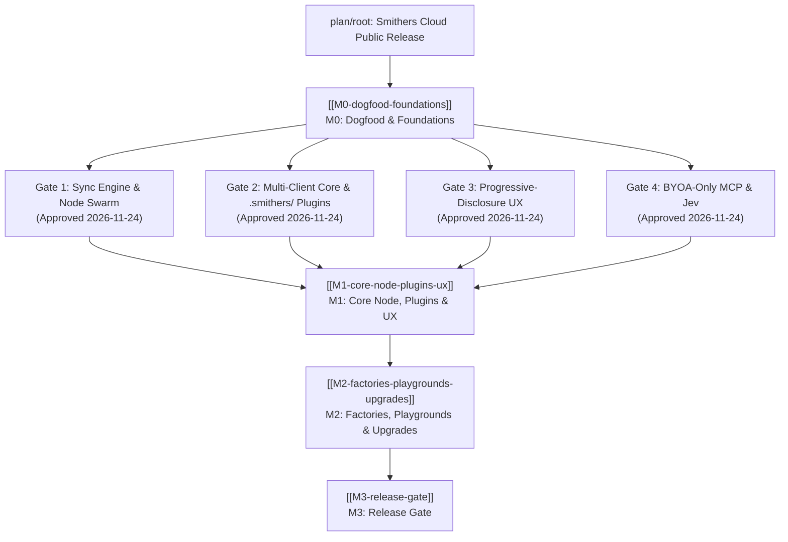

# Smithers Cloud Public Release Plan Tree

Target: Quiet launch of `smithers.sh` (`apps/mvp`) plus self-hostable local-first node runtime first, loud launch next week. Ship above slop. Dogfood inside Smithers from Day 1 (`smithers.sh/evmts/voltaire` baseline, private `Smithers-Ops` visible only to `roninjin10`).

## Live Execution Progress (2026-11-25)

- **Landed on main:** 17 verified commits (`85aa0fc1` to `3b38cfaf`)
- **M1 Core, Sync & UX:** BYOA stdio MCP bridge, multi-node SQLite swarm convergence + overflow burst tests, WorkbenchScreen + WaitlistScreen + Command Palette, approval typing-focus guard, conversation pane restoration, PR keyboard review navigation, Decision 0017 plugin deletion gate, and zero-`jjhub` gate are landed on `main`. ADR 0170 Slice 3 `MessagesShard` Astra security fixes + Lean 4 specs are finishing verification.
- **M2 Factories, Playgrounds & VibeLang:** 30 worker modules migrated to idiomatic `.vibe` at 100% V8 coverage (Slices 1-5 landed, Slices 6-7 in flight), canonical `.smithers/workflows/gate.vibe` + 4-client parity landed, 9-repo factory matrix + 7 `smithersai/` fork attribution landed, VibeStack UI patterns doc landed, and Astra-approved `PlaygroundBridge` (`sandbox="allow-scripts"`) landed.
- **M3 Release Gate:** Production canary suite (`apps/mvp/ops/canary/run.ts`) with `maxRedirects: 0` SPA checks, 7-fork checks, and private `Smithers-Ops` fail-closed checks added. Quiet launch Alchemy deploy queued right after `W5-SYNC` clears Astra and lands.

## Gate Decisions

- [x] Gate 1: Sync Engine & Node Swarm. Approved by Will 2026-11-24. [Decision 0170](../../apps/mvp/docs/decisions/0170-sqlite-shards-replace-electric.md)
- [x] Gate 2: Multi-Client Core & `.smithers/` Plugins. Approved by Will 2026-11-24. [Decision 0171](../../apps/mvp/docs/decisions/0171-one-core-four-clients-and-workflows-dir.md)
- [x] Gate 3: Progressive-Disclosure UX. Approved by Will 2026-11-24. [Decision 0172](../../apps/mvp/docs/decisions/0172-progressive-disclosure-and-cause-receipts.md)
- [x] Gate 4: BYOA-Only MCP & Jev. Approved by Will 2026-11-24. [Decision 0173](../../apps/mvp/docs/decisions/0173-byoa-only-mcp-attach-and-jev-config.md)

Each gate took its recommended options (Gate 1: 1A and 2A, Gate 2: 1A and 2A, Gate 3: 1A and 2A, Gate 4: 1A and 2A).

## Tree Overview

## Wave 1 Fleet & Account Readiness (Verified 2026-11-24 17:24 PT)

### Compute Fleet

| Host | Reachability | Resources | Live Work Detected (Do Not Clobber) | Action / Warning |
| --- | --- | --- | --- | --- |
| MacBook Pro (`Williams-MacBook-Pro-3.local`) | Local | **2.4 GiB free** on `/` (CRITICAL) | 25 tmux sessions (`antigravity`, `smithers-design`, `fuzz-site`, `needlefish-09`, `recovery-dash`, etc.) | Coordinator and light checks ONLY. Zero builds or workspaces here. |
| Mac mini (`Williams-Mac-mini.local`) | SSH OK | 199 GiB free, 40d uptime | `smithers-backend`, `postgres`, `alchemy` exec | Ready for self-hosted node dogfooding, local CI, and `mini-run` test slots. |
| Latitude `nyc-02` | SSH OK | 251 GiB RAM (214 GiB avail), **33 GiB free (99% full)** | `smthrs-fleet` serving `https://smithers.sh --cfbox`, VibeLang fuzz (`ws-fuzz-100`) | Ready for heavy compute once stale artifacts trimmed. Watch `cpu-slices.sh` 5-core pin (no wall-time benchmarks). |
| Latitude `nyc-01` | Port 22 open, **SSH hangs** | Unknown (direct and jump hang) | Likely under `MemoryHigh` / SSH saturation | Needs host check or `lane-exec` recovery before assigning lanes. |
| Cloudflare (`cfbox` + Alchemy) | `cfbox list` OK, `smithers.sh` HTTP 200 | Up to 500 burst sandboxes | Stale Nov 14 reserved jobs in `cfbox list` | Ready for burst parallel test/fuzz shards and Alchemy deploys (check `/version` before `--yes`). |

### Model Tiers

Tier split: Gemini 4 Neon owns UI, copy and docs. Codex Sol takes about 40% of non-UI work, Claude Opus about 30%, Claude Fable about 20%, and the peak panel about 10% (Gates, security boundaries, core state machines). Per-account quota and reset state lives in the coordinator's private notes, not in the repository.

## Tiered Backpressure Protocol (Incremental via `smthrs affected`)

| Tier | Cadence | Target Time | Exact Gate Commands | Execution Host |
| --- | --- | --- | --- | --- |
| `fast-check` | Every edit / leaf iteration | 5-30s | `smthrs affected --kinds lint,typecheck,test` + headless MCP/SDK contract suite | Mac mini / `nyc-02` / `cfbox` |
| `medium-check` | Every completed Plan Tree leaf & integration join | 2-5 min | Cross-package integration tests + affected Playwright E2E + bounded property/fuzz checks + targeted Lean 4 proofs | `nyc-02` / `cfbox` (Postgres tests on `run-heavy --image pg` or Mac mini compose) |
| `full-check` | Milestone gates (M0, M1, M2, M3) & release candidates | 10-25 min sharded | Full E2E + GIF verification (`pnpm e2e:gifs:check`) + deep arbitrary fuzzing + full Lean proof suite + local/live benchmarks + prod canary checks | Sharded across `cfbox` + `nyc-02` + `nyc-01` |

## Anti-Drift & Orchestration Invariants

1. **Direct source pointers only**: Every leaf prompt links directly to its Plan Tree node, contract file, and ruling file. No paraphrased copies.
2. **Living plan updates**: Whenever a POC or implementation breaks an assumption, update the node's `assumptions` checklist and `[[wikilinks]]` before continuing.
3. **Binary Definition of Done**: Every leaf is `done` (exit code `0` + verified disk artifacts + landed commit on `main`) or `not_done`. Never "almost done".
4. **Hard circuit breaker**: Max 2 repair cycles per leaf. If still red, stop, write a blocker note (evidence, root cause, smallest unblock), and escalate.
5. **Hard Security Rule**: Zero `eliza` / `elizaOS` code on any local or bare-metal host. Strictly isolated Cloudflare Sandbox with zero host secrets.
