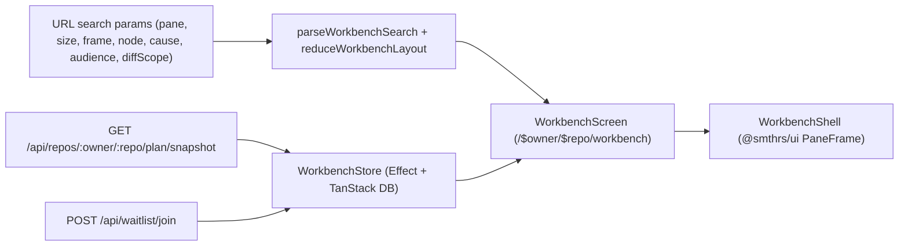

# Workbench

Progressive-disclosure repository workbench over URL-owned layout state, local TanStack DB collections, and `@smthrs/ui`.

## Routes

| Route | Screen | Gate |
| --- | --- | --- |
| `/$owner/$repo/workbench` | `WorkbenchScreen` | `repoGated` |
| `/app/waitlist` | `WaitlistScreen` | Public |

## Progressive disclosure tiers

- **Inline:** Chat and activity summary beside a compact pane preview.
- **Side inspector:** Split grid showing chat and the active pane side by side.
- **Full pane:** Maximized pane outside chat for Plan Tree, BYOA MCP attach, workflow run inspection, state machine proofs, diff review, or repository hosting waitlist.

## Keyboard shortcuts

Shortcuts ignore editable inputs, IME composition, modified chords, and already handled events.

| Key | Action |
| --- | --- |
| `1` to `6` | Switch active workbench pane |
| `[` and `]` | Step backward or forward across replay frames |
| `0` | Return to the live frame |
| `Escape` | Step down from full to side, or side to inline |

## Audience lens

The audience switcher defaults to the signed-in person role on the repository and clamps strictly downward (`maintainer` -> `contributor` -> `visitor`). No view can escalate above the repository role returned by the server.

## Sandboxed Playgrounds

Press `7` or open the `Playground` pane on supported first-party repositories (`evmts/tevm-monorepo`, `evmts/tevm-effect`, `evmts/zevm`, `smithersai/vibelang`, `smithersai/smithers`) to run bounded, credential-free workflow fixtures inside an isolated `sandbox="allow-scripts"` iframe.
