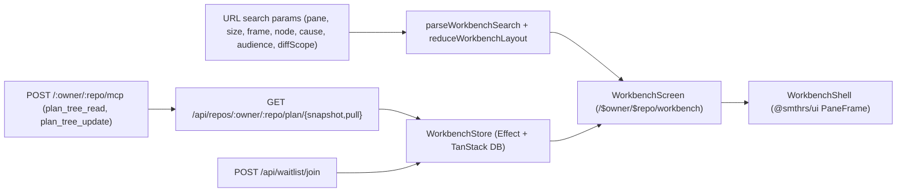

# Workbench

Progressive-disclosure repository workbench over URL-owned layout state, local TanStack DB collections, and `@smthrs/ui`.

## Routes

| Route | Screen | Gate |
| --- | --- | --- |
| `/$owner/$repo/workbench` | `WorkbenchScreen` | `repoGated` |
| `/app/waitlist` | `WaitlistScreen` | Public |

## Progressive disclosure tiers

- **Inline:** Chat and activity summary beside a compact pane preview.
- **Side inspector:** Split grid showing chat and the active pane side by side.
- **Full pane:** Maximized pane outside chat for Plan Tree, BYOA MCP attach, workflow run inspection, state machine proofs, diff review, or repository hosting waitlist.

Plan node sources with valid HTTP or HTTPS URLs open in a new tab. File paths and other source references stay readable as text. Artifact links use the viewer’s existing access.

## Keyboard shortcuts

Shortcuts ignore editable inputs, IME composition, modified chords, and already handled events.

| Key | Action |
| --- | --- |
| `1` to `6` | Switch active workbench pane |
| `[` and `]` | Step backward or forward across replay frames |
| `0` | Return to the live frame |
| `Escape` | Step down from full to side, or side to inline |

## Audience lens

The audience switcher defaults to the signed-in person role on the repository and clamps strictly downward (`maintainer` -> `contributor` -> `visitor`). No view can escalate above the repository role returned by the server.

## Sandboxed Playgrounds

Press `7` or open the `Playground` pane on supported first-party repositories (`evmts/tevm-monorepo`, `evmts/tevm-effect`, `evmts/zevm`, `smithersai/vibelang`, `smithersai/smithers`) to run bounded, credential-free workflow fixtures inside an isolated `sandbox="allow-scripts"` iframe.

## Plan Tree shard contract

The Workbench reads a repository's durable Plan Tree through the shared protocol v2 contract in `src/features/workbench/planContract.ts`:

1. `GET /api/repos/:owner/:repo/plan/snapshot?shard=repo:<owner>/<repo>` returns `{ position: { shard, epoch, seq }, state }` with `cache-control: no-store`. Before first compaction `state` is `null`.
2. `GET /api/repos/:owner/:repo/plan/pull?v=2&shard=...&epoch=...&after=...&limit=256` streams every uncompacted journal tail entry after `position.seq` via `@smthrs/sync` `ShardClient`, folding `PlanEvent` records through `applyPlanDeliveryEffect`.
3. Authorized agents read and update the same durable `PlanTreeObject` through the repository MCP tools `plan_tree_read` (Member+, `mcp:read`) and `plan_tree_update` (Maintainer+, `mcp:write`, atomic SQLite idempotency). Marking a node `done` stays strictly person-only (`plan/review`).

### Observability

- Worker routes record `plan.route` logs/spans and `smithers_plan_tree_requests` (`operation`, `outcome`).
- Repository MCP Plan Tree calls record `mcp.plan_tree` logs/spans and `smithers_mcp_tool_calls`.
- The browser store records `workbench.plan.load` spans, `workbench.plan.load_failed` warnings, and `smithers_workbench_plan_loads` (`outcome`).
- Tokens, logins, node titles, and command payloads never appear in logs, spans, or metrics (OBS-5).
