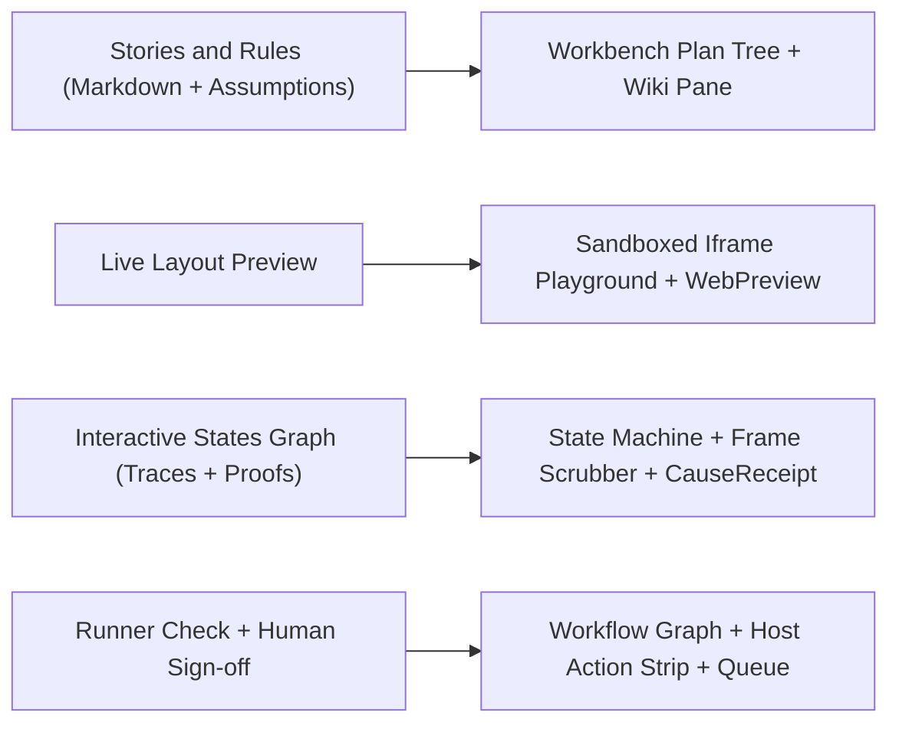

# VibeStack Studio and Smithers Cloud UI patterns

This note maps the public VibeStack Studio multi-pane workflow onto the existing Smithers Cloud workbench and plugin architecture. All research used public specifications and documentation without touching local untrusted repositories.

## Pattern mapping

| VibeStack Studio surface | Smithers Cloud counterpart | Adoption plan |
| --- | --- | --- |
| Stories and Rules pane | Plan Tree pane, Wiki, and assumption badges in [WorkbenchShell](../../src/features/workbench/WorkbenchShell.tsx) | Keep markdown specifications and verification receipts paired side-by-side inside the Plan pane. |
| Live Layout Preview pane | Sandboxed iframe playgrounds and [WebPreview](../../worker/WebPreview.vibe) | Render live repository playgrounds (including Tevm and Zevm blockchain sandboxes) inside a strict sandboxed iframe bridged only through typed workflow calls. |
| Interactive States Graph pane | State Machine pane, replay frame scrubber, and CauseReceipt drawer | Step backward and forward through committed shard frames with `[`, `]`, and `0` while displaying the exact actor, flow, and receipt for each transition. |
| Runner Check and Sign-off bar | Workflow pane, Queue, and host-owned [action strip](../../src/plugins/strip.ts) | Keep approval identity shared across run cards and queue items while holding focus when the person is typing in another editor. |
| Strict domain vs React split | Effect stores, TanStack DB collections, and thin React views | Zero React state hooks inside app feature logic. Every user action runs through Effect services and shared local-first contracts. |

## Next UI milestones

1. Wire per-conversation workbench snapshot restoration and compact viewport clamping in [WorkbenchScreen](../../src/screens/workbench/WorkbenchScreen.tsx).
2. Add live sandboxed iframe playground embedding for M2 first-party repositories (Tevm, Zevm, VibeLang, and Smithers).
3. Surface shared approval request badges across conversation cards and the review queue using [approvalGuard](../../src/features/status/approvalGuard.ts).
