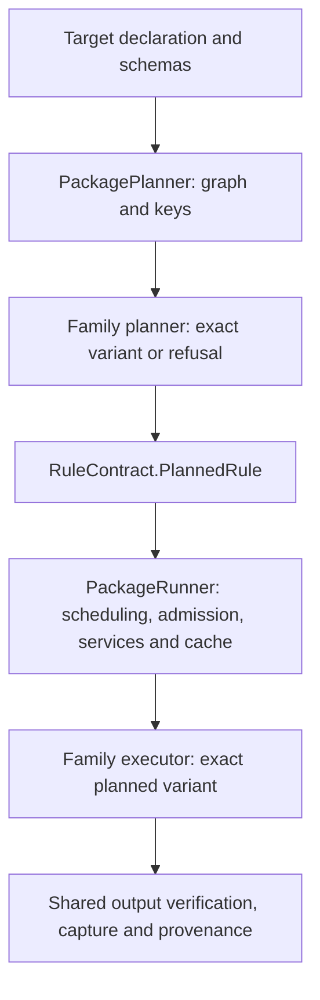

A package target becomes a discriminated planned rule before execution.
`internal/RuleContract.ts` owns that internal union. Its `family`, `rule`,
and `lane` agree: a Fetch carries a URL and digest, a Docs.Check carries its
stamp operands, and a Shell.Serve carries its resolved command and service
probes. An incomplete plan has an explicit refusal. Native rule names cannot
enter the custom declaration-body fallback without their payload.

Fetch, Copy, Literal, and Docs.Check have paired planners and executors in
`internal/rules`. `NativeRules` selects the pair from one registry. Fetch
requires exactly one output, execute mode, and intrinsic network access;
native file rules require one output; Docs.Check carries its resolved input
closure. Process rules require a nonempty resolved command. The union also
enforces the remaining rule/lane and agent-flavor relationships.

## Execution boundaries

The Fetch pair is `internal/rules/FetchPlan.ts` and
`internal/rules/FetchExecutor.ts`, joined by `FetchRule.contract`.
The planner resolves the package-relative output without network or filesystem
access. The executor reads the planned URL, digest, and destination; it does
not read the declaration again. It streams into a temporary file, verifies
the digest, and publishes by rename using the existing limits and errors.

`PackageExec.ts` is the public facade. `PackagePlanner` owns graph expansion,
input resolution, and preview keys. `PackageRunner` owns admission, service
acquisition, execution, output verification, and cache publication. Its
artifact lifecycle restores before running and captures only a successful
result. `RulePolicy` declares each rule's default mode, cache eligibility,
capabilities, and scheduling flags in one place. Its table is typed against
the native rule union, so a new or renamed rule fails typecheck until its
policy is stated. `ServiceSupervisor` owns service lifetimes; extracting a
rule introduces no new scheduler or cache.

The public `FetchExec` functions remain adapters to the same planner and
download implementation. Its error class, limits, result type, and URL
redactor are reexports of their single implementation owner. There is no
second download path. Other public declaration constructors and schemas are
unchanged. Schema checks at declaration and persisted-cache boundaries and
runtime refusal on unsupported hosts remain necessary; the internal union
does not validate untyped or serialized values.

## Semantic owners

| Concept                                              | Owner                                         | Adapters and deliberately distinct views                                                                                                                                           |
| ---------------------------------------------------- | --------------------------------------------- | ---------------------------------------------------------------------------------------------------------------------------------------------------------------------------------- |
| Target declarations, attrs and declared outputs      | `@smthrs/targets/Target` and each rule schema | `TargetExecution` lowers a declaration body with `Target.plan` inside an executor-owned Flow. Native package rules use their planned family.                                       |
| Planned rule payloads and shared package node fields | `internal/RuleContract`                       | `PackageExec.PackageNode`, `Mode`, `LaneData`, `CrateRow`, and `TestOperandPlan` are aliases, not duplicate definitions.                                                           |
| Declared file inputs and digests                     | `@smthrs/targets/Input`                       | `Workspace.ExpandedInput` is the anchored, expanded planner view. It is not another declaration schema.                                                                            |
| Package dependency reasons                           | `PackageIndex.Edge`                           | `Planner.Edge` is the scheduler's direction and label projection. The mapping stays explicit because declaration edges distinguish data, tools, and services.                      |
| Build key material and encoding                      | `Planner`                                     | Package planning contributes rule attrs and resolved facts. Durable Flow topology and journal identity remain owned by their respective packages.                                  |
| Resolved environment                                 | `NixExec.ResolvedEnvironment`                 | `Planner.PlannedEnvironment` projects the store path, hash, closure, PATH, and variables needed at execution; resolver diagnostics and declaration facts are intentionally absent. |
| Fetch planning and transport                         | `FetchPlan` and `FetchExecutor`               | `FetchRule` pairs them; `FetchExec` preserves the public call shape without duplicating behavior.                                                                                  |
| Process service lifetime                             | `ServiceSupervisor`                           | Declaration probe schemas validate attrs. The supervisor's host-facing readiness, health, and stop types describe the reduced runtime contract.                                    |
| Output manifests and workspace snapshots             | `PackageTree`                                 | `Cache` owns the persisted entry envelope and content store. `PackageRunner` decides when an entry is reusable and when to publish provenance.                                     |

`CoreRuleSelection` is a temporary adapter for the core rules still planned
inline. Its native-lane name table is checked against the union at compile
time, so adding a native variant also requires guarding the body fallback.
The remaining specialized dispatch stays in `PackagePlanner` and
`PackageRunner`, behind the same shared policy and scheduler. New native
families should join `NativeRules` with a paired contract instead of adding
independent planning and execution cases.

## Equivalence and coverage

`FetchRuleEquivalence.test.ts` retains goldens recorded before extraction:
complete semantic key material, report, cache provenance, output bytes and
mode, replay after deletion, and bypassed cache reads. Only ambient host
identity, the implementation fingerprint, timestamps, and the local HTTP
fixture's port are normalized. Production still fingerprints the changed
implementation; existing key-format salts and stored records are unchanged.

`FetchRuleContract.test.ts` checks the exact executor against the public
adapter, output-path refusals, typed failures with original causes,
cancellation, and byte limits at N-1, N, and N+1. `PlannedRule.types.ts`
contains negative compilation tests for invalid rule/lane, command,
output, service, and execution-policy combinations.

The original PackageExec coverage floor also gates the combined extracted
planner, runner, policy, and native rule modules. Moving code does not remove
it from the gate. Existing per-backend floors remain in place.

## Current scheduler and dispatch owners

`Executor` owns `schedule`, `mergePlans`,
concurrency validation, report types, and the cache-output codecs.
`PackageRunner.execute`, reexported by `PackageExec`, coordinates rule dispatch, cache decisions, services,
and output capture, calling that shared scheduler. `TargetExecution.runTarget`
is the adapter that lowers declaration bodies into the isolated Flow runtime.
There is no second rule-dispatch loop in `Executor` to extract.

The remaining convergence work is between native family execution and that
declaration-body adapter. Their different input contracts still justify an
explicit boundary while each native family earns its own equivalence evidence.

## Affected read contracts

The internal `RulePolicy` table owns both intrinsic sandbox overrides and
which execution routes can omit package membership during affected selection.
The planner and selector call the same declaration-only policy resolver.
The planner and selector also share native build-output resolution. The selector
matches the literal readable directory grants from outputs, output-file parents,
the execution cache and dependency directories; these yield `sandbox-input`
causes, including for paths outside the declaring package. It uses the same
package-manager file and dependency-directory helpers as execution.

Symbolic-link file inputs may have a different spelling from their referent.
They retain an `indirect-input` any-change fallback, including matching file
links in globs. The bounded scan never descends through directory links and surveys nested
packages conservatively because explicitly entered repositories can admit them.
Unreadable or over-budget scans remain conservative.

An unknown rule retains package selection. Adding a native rule does not
implicitly promise confined reads.

| Rule family                                                          | Read contract and selection                                                                                                                                                                                                   |
| -------------------------------------------------------------------- | ----------------------------------------------------------------------------------------------------------------------------------------------------------------------------------------------------------------------------- |
| `Shell.Build`, `Shell.Test`, `Shell.Run`                             | Their runner dispatches through `spawnConsumer` and `spawnNode`, which pass `sandboxRequest` to the exec boundary. Omit package membership only with an explicit enforcing workspace mechanism and confinement in every kind. |
| `Filegroup`                                                          | Planning expands declared inputs; execution only caches a filegroup verdict. Nested files arrive through declared dependencies. Omit package membership.                                                                      |
| `Cargo.AppSet`                                                       | `appSetCrates` expands its declared manifest globs and reads those manifests. Execution is a value verdict. Omit package membership.                                                                                          |
| `Go.Packages`                                                        | Execution returns a value verdict; its selectors are declarations, not executable commands. Omit package membership.                                                                                                          |
| `Suite`                                                              | Execution examines the recorded statuses of declared members. Omit package membership.                                                                                                                                        |
| `Alias`                                                              | Execution examines the recorded status of the declared aliased target. Omit package membership.                                                                                                                               |
| `Materialize`, `Clean`, `Install`                                    | Materialization verifies existing output trees; cleaning mutates output paths; installation reads and writes dependency state through the install service. Keep package membership.                                           |
| `Generate`, ownership projections, `Github.CiGen`, `Copy`, `Literal` | Check modes inspect existing destinations, beyond declared source inputs. Keep package membership.                                                                                                                            |
| `ImportClosure`, native language rules, bundlers                     | Planning or host execution discovers imports, compiler inputs, manifests, configuration or graph data. Exec confinement alone does not describe those reads. Keep package membership.                                         |
| Other native rules and custom bodies                                 | Host-side operations, services, generated-output checks and declaration bodies lack a declaration-only complete read contract. Keep package membership.                                                                       |

The uncacheable, ambient-input and empty-declaration fallbacks still apply to
every row. This is a selection refinement over complete contracts, not a way to
make an incomplete contract cacheable.
